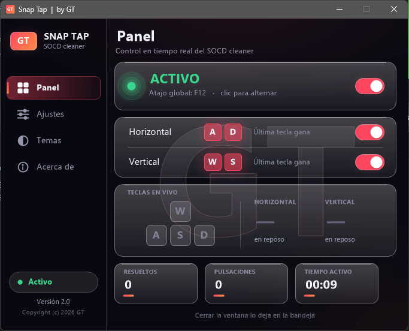

# Snap Tap

**SOCD cleaner para W/A/S/D con interfaz de cristal oscura**

Hecho por **GT**

---

## Descarga

Descargá la última versión desde **[Releases](https://github.com/anotherare/SnapTap-GT/releases/latest)**.
No necesita instalación: ejecutá `SnapTap.exe` y listo.

## ¿Qué hace?

Snap Tap resuelve los conflictos de teclas opuestas (SOCD): cuando mantenés **A y D** (o **W y S**) a la vez,
gana siempre **la última tecla que pulsaste**. Al soltarla, se reactiva la anterior si seguís manteniéndola.

Funciona con un hook de teclado de bajo nivel y envía las teclas por scancode, sin dependencias externas.

## Características

- **Pantalla de inicio** animada con el logo GT de cristal (se puede omitir).
- **Interfaz de cristal oscura** con fondo acrílico en Windows 11 (y fondo sólido en Windows 10).
- **Panel** con estado, interruptores por eje, visor de teclas en vivo y estadísticas.
- **6 temas** de color con transición suave: Violeta, Océano, Esmeralda, Carmesí, Ámbar y Neón.
- **Efectos visuales**: partículas, aurora, resplandor del cursor, ondas al hacer clic y slider de intensidad.
- **Ajustes**: siempre visible, iniciar con Windows, cerrar a la bandeja, notificaciones y atajo global
  configurable (F12, F11, F10 o Pausa).
- **Bandeja del sistema** con icono dinámico y menú para cambiar de tema.
- Los ajustes se guardan automáticamente en `HKCU\Software\GT\SnapTap`.

## Uso

| Acción | Cómo |
|---|---|
| Pausar / reanudar | Atajo global (por defecto **F12**) o interruptor del panel |
| Cambiar de sección | Barra lateral o teclas **1** a **4** |
| Omitir la pantalla de inicio | Cualquier tecla o clic |
| Cambiar de tema | Sección **Temas** o menú de la bandeja |
| Salir | Menú de la bandeja → **Salir** (o desactivá *Cerrar a la bandeja*) |

## Antivirus

Como Snap Tap intercepta el teclado para resolver los conflictos de teclas, algunos antivirus pueden
marcarlo como falso positivo. Es una limitación de cualquier programa que usa un hook de teclado.
Si querés verificar tu descarga, compará el hash SHA256 que figura en la descripción de cada release.

## Aviso

Algunos juegos, sistemas anti-trampas y torneos prohíben o restringen el uso de herramientas que
modifican las entradas del teclado. **Usalo bajo tu propia responsabilidad** y revisá las reglas de
cada juego o competencia antes de hacerlo.

## Licencia

Software propietario, de uso gratuito. Ver [LICENSE](LICENSE). © 2026 GT
